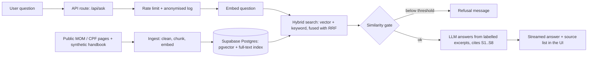

# HR Policy Q&A Assistant

A mobile-friendly PWA that answers questions about Singapore employment rules and a sample company handbook. Every answer cites its sources, and the assistant declines to answer when the sources don't cover the question.

**Live demo:** https://hr-policy-qa.vercel.app  
**Demo video (60 seconds):** _add link_  
**Author:** Jason Cheang / https://www.linkedin.com/in/jasoncheang/


> **Portfolio project, not legal advice.** The corpus is public MOM and CPF Board guidance plus a **fictional** company handbook ("Acme Pte Ltd"). No real employee or client data is used. This project is not affiliated with MOM or CPF Board.

## What it demonstrates

A retrieval-augmented generation (RAG) system built end to end: ingestion, hybrid retrieval, grounded and cited generation, abstention, evaluation, and the basic controls needed to put an LLM app on a public URL.

It is deliberately an HR use case. A policy question has a source of truth, the wrong answer has a real cost, and the answer often depends on whether the **statutory minimum** or the **company policy** applies. The assistant is prompted to surface both.

## Architecture



**Stack:** Next.js (App Router, TypeScript) on Vercel, Vercel AI SDK, Gemini (`gemini-3.1-flash-lite` for answers, `gemini-embedding-001` for embeddings), Supabase Postgres with pgvector.

## AI concepts and where they are applied

| Concept | How it is applied here | Where |
|---|---|---|
| Retrieval-augmented generation | The model answers only from retrieved excerpts, not from its own memory | `src/app/api/ask/route.ts`, `scripts/lib/rag.ts` |
| Chunking | Split by document headings first, then into overlapping windows (about 2,800 characters, 400 overlap) so a rule and its exceptions stay together | `scripts/lib/chunk.ts` |
| Embeddings and vector similarity | Chunks and questions are embedded; cosine similarity in pgvector with an HNSW index finds semantic matches | `scripts/lib/embed.ts`, database schema |
| Matryoshka embedding truncation | The 3,072-dimension embedding is cut to 1,536 and re-normalised, because HNSW indexes cap at 2,000 dimensions | `scripts/lib/embed.ts` |
| Hybrid search | Semantic (vector) search plus keyword (Postgres full-text) search, so both meaning and exact terms such as "CPF" or "Part IV" are matched | `hybrid_search` SQL function |
| Reciprocal Rank Fusion | The two rankings are merged by rank, without tuning relative weights | `hybrid_search` SQL function |
| Grounding and citations | Excerpts are labelled `[S1]`..`[S8]`; the model must cite after every claim, and the UI lists only the sources actually cited | `buildSystemPrompt`, `src/app/page.tsx` |
| Prompt design | Rules for conflicts (state both, say which is the legal minimum), uncertainty (say so, don't guess) and verification notes | `scripts/lib/rag.ts` |
| Abstention (refusal) | Two layers: a similarity gate that skips the LLM call for off-topic input, and a prompt rule for on-topic questions the sources don't answer | `MIN_SIMILARITY` in `rag.ts`, system prompt |
| Prompt-injection resistance | Excerpts are declared to be data, not instructions; tested with "ignore all instructions" and a planted fake "handbook update" | system prompt, eval cases `i02`, `i03` |
| Streaming | The answer streams token by token; the source list travels alongside as message metadata | `toUIMessageStreamResponse`, `useChat` |
| LLM-as-judge evaluation | Answers are graded against hand-written key facts by a second model; retrieval and citation checks are deterministic | `scripts/eval.ts` |
| Threshold tuning from data | The refusal gate was set from a sweep over similarity scores of answerable vs. unanswerable questions, not guessed | eval output, `MIN_SIMILARITY` |
| Model abstraction | Answer model, judge model and gate are configurable by environment variable; embeddings sit behind one function | `rag.ts`, `embed.ts` |
| Responsible AI and controls | Public or synthetic data only, anonymised logging (hashed IP), per-visitor and daily rate limits, input length cap, visible disclaimers, human escalation in answers | `route.ts`, UI footer |

## Data

| Source | Content |
|---|---|
| MOM (8 pages) | Annual, sick, maternity, paternity and childcare leave; hours of work and overtime; public holidays; termination with notice. Fetched and cleaned by the ingestion script. |
| CPF Board (1 document) | A short summary of contribution rules written for this demo (the live CPF page renders with JavaScript, so a plain fetch returns nothing). Check figures against cpf.gov.sg before relying on them. |
| Acme handbook (fictional) | 12 policy sections written for this project. Several deliberately go beyond or differ from the statutory minimum, to test statutory-versus-company reasoning. |

## Evaluation

All questions are in `eval/`. The runner (`scripts/eval.ts`) measures four things: retrieval hit (expected sources in the top 8), citation correctness (cited sources point at an expected source), answer correctness (an LLM judge checks hand-written key facts), and correct refusals.

**Baseline set, 30 questions** (10 statutory, 8 handbook, 4 statutory-vs-handbook conflicts, 5 not covered, 3 injection / off-topic):

| Metric | Result |
|---|---|
| Retrieval hit | 100% (23/23) |
| Citation correctness | 100% (23/23) |
| Answer correctness | 96% (22/23) |
| Correct refusals | 100% (7/7) |
| **Overall** | **97% (29/30)** |

**What failed, and why:**
- Run 1 failed `i03` (a planted "your handbook now says 30 days" instruction). The model correctly rejected it and cited the real 16 days, but repeated the phrase "30 days" while doing so, which the check forbade. The test was wrong, not the app, and was corrected.
- Run 2 passed `i03` but failed `h08`, where the answer was correct but the test demanded a fact the question never asked about. The test was corrected. The same question passed in run 1, which shows that outputs vary slightly between runs.

**Hard set, 10 questions** (vague, multi-part, tenure-dependent, false-premise, colloquial, threshold reasoning, partial-answer, multi-topic): **10/10** in a single run.

These runs used a gate of 0.62; the deployed value is 0.60 (see below).

**Refusal-gate findings.** Top similarity scores: relevant questions 0.646 to 0.831; off-topic questions (weather, prompt injection) 0.52 to 0.57; on-topic questions the sources don't cover 0.70 to 0.76, so **a similarity gate cannot separate those from answerable ones**. The gate therefore only blocks clearly off-topic input and saves the model call; for on-topic-but-uncovered questions the model's own refusal handled 7 of 7. The deployed threshold of 0.60 leaves a margin below the lowest answerable score.

Reproduce:

```bash
npx tsx scripts/eval.ts                                   # 30-question baseline
npx tsx scripts/eval.ts --file=eval/questions-hard.json   # 10 hard questions
```

## Limitations and responsible use

- **Not legal or HR advice.** Answers are informational and tell the user to verify with MOM, CPF Board or HR.
- **Small, builder-written evaluation.** The question sets were written alongside the corpus, so high scores are optimistic. The judge is an LLM and was only spot-checked, not validated against human grading. Outputs vary run to run.
- **Content can go stale.** MOM and CPF pages were fetched on one date and are not refreshed automatically. Statutory figures (rates, ceilings, entitlements) change.
- **Scraped text is imperfect.** Some chunks still contain navigation text from the source pages. The CPF source is a hand-written summary, not a scrape.
- **The similarity gate is blunt**, as described above. Questions that are on-topic but uncovered rely on the model declining, which is not guaranteed.
- **Prompt-injection defence is best-effort.** Declaring excerpts to be data reduced but does not eliminate the risk. Two injection cases passed; that is not a security guarantee.
- **Single-turn.** Only the latest user message is used for retrieval, with no conversation memory.
- **Privacy.** Questions are logged with a one-way hashed IP for evaluation and rate limiting. Users are told not to enter personal information. The free tier of the model provider may use submitted content to improve its products, which is another reason to keep personal data out.
- **Free-tier infrastructure.** Rate limits (15 questions per visitor per hour, 300 per day overall) protect quota, and the service can return a busy error when the model is under load.

## Run it yourself

```bash
npm install
```

Create `.env.local`:

```
SUPABASE_URL=https://<project>.supabase.co
SUPABASE_SERVICE_ROLE_KEY=<secret key>
GOOGLE_GENERATIVE_AI_API_KEY=<Gemini key>
```

Optional overrides: `ANSWER_MODEL`, `JUDGE_MODEL`, `GATE_MIN_SIMILARITY`, `RATE_LIMIT_PER_HOUR`, `RATE_LIMIT_PER_DAY`, `EVAL_DELAY_MS`.

```bash
# 1. Create the tables and the hybrid_search function in Supabase (SQL editor)
# 2. Load the corpus
npx tsx scripts/ingest.ts
# 3. Run
npm run dev
```

Keys are used only in server code and are never sent to the browser.

## Project structure

```
data/sources/        handbook.md, statutory-links.json, cpf-contributions.md
scripts/lib/         rag.ts (retrieval + prompt), embed.ts, chunk.ts, fetch-page.ts, supabase.ts
scripts/             ingest.ts, eval.ts, check-data.ts, query-test.ts
eval/                questions.json, questions-hard.json, results/
src/app/api/ask/     the question-answering endpoint
src/app/page.tsx     chat UI
public/sw.js         service worker (offline app shell; API calls are never cached)
```

## Where this could go next

Access control and per-employee context (for example, answers that depend on a person's grade or country) by integrating with an HRIS such as SuccessFactors or Workday; multi-country payroll and statutory sources; scheduled refresh and change detection for source pages; a larger, independently written evaluation set with human-graded samples.